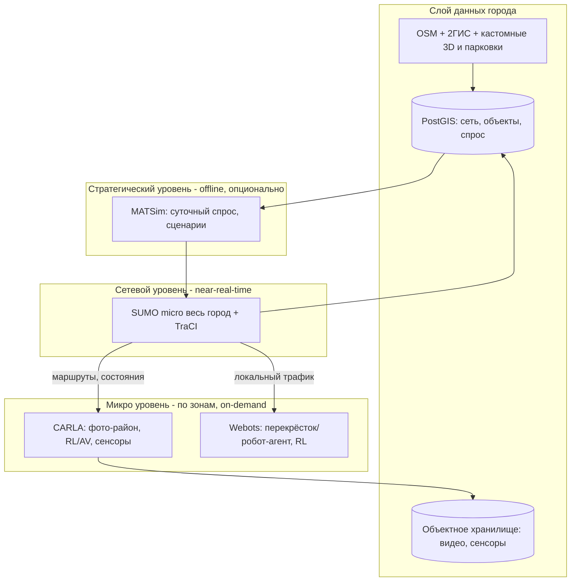
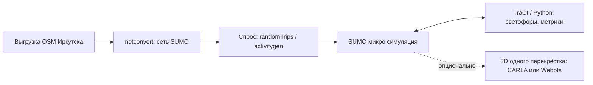
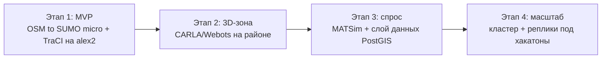

# Фаза 10: Архитектурное ревью стека транспортного моделирования (оптимистичный сценарий — Иркутск)

> **Документ:** `10-traffic-sim-architecture-optimistic.md`
> **Версия:** 1.0
> **Статус:** Действующий
> **Область применения:** Центр ИИ, Tech Lead, команда разработки, администрация (запрос на железо)
> **Связанные материалы:** [`09-traffic-sim-architecture.md`](09-traffic-sim-architecture.md), [`briefing.html`](briefing.html), `meeting1.txt`, `meeting2.txt`, [`00-project-charter.md`](00-project-charter.md)

---

## 10.1 Контекст и постановка задачи

Документ повторяет архитектурное ревью из [`09-traffic-sim-architecture.md`](09-traffic-sim-architecture.md), но берёт за эталон масштаба **город размера Иркутска** (~0.6 млн жителей) вместо Нью‑Йорка (~8.5 млн). Это «оптимистичный» сценарий: при том же стеке масштаб задачи падает примерно **на порядок (~10–20×)**, и почти все требования смещаются в более лёгкую сторону.

Требуется **транспортная модель всего города** с автомобилями и их транспортными потоками, а также с объектами, влияющими на городскую инфраструктуру: здания, светофоры, дорожные знаки, пешеходы, общественный транспорт.

Назначение модели (из `meeting1.txt`, `meeting2.txt`, `briefing.html`):

- основа для хакатонов, привязанных к центру организации дорожного движения и центру ИИ;
- переход интеллектуальной транспортной системы (ИТС) с уровня 0 на уровень 1 (например, детекторы на светофорах с реакцией на поток);
- концепция/модель плана эвакуации города (для Иркутска особенно важны мосты через Ангару как «бутылочные горлышки»);
- аналитика парковок (ёмкость, загрузка по часам), скорости на отрезках, сбор слоёв данных;
- обучение ИИ-агентов (водители, пешеходы) — задача центра ИИ.

Рассматриваются те же **две идеи**:

1. **Идея 1.** Использовать **Webots** для всего — построение города из OSM и симуляция всего города в одном инструменте.
2. **Идея 2.** Комбинировать **MATSim + SUMO + CARLA + Webots** (предложено в `briefing.html`): MATSim и SUMO — для крупного масштаба, CARLA и Webots — для микроуровня, где важно поведение агентов.

---

## 10.2 Масштаб: Иркутск против Нью‑Йорка

| Параметр | Нью‑Йорк | Иркутск | Разница |
|----------|----------|---------|---------|
| Население | ~8.5 млн | ~0.6 млн | ~14× |
| Автопарк (оценка) | миллионы | ~0.2 млн | ~10–15× |
| Одновременно на сети в пик (оценка) | сотни тысяч | ~15–40 тыс. | ~10–20× |
| Сложность графа | огромная, многоуровневая | средняя, естественные «горлышки» (мосты через Ангару) | значительно проще |
| Доступность исходных данных | сложнее | выше (2ГИС + OSM, см. `meeting1.txt`) | в пользу Иркутска |

> Цифры по Иркутску — порядковые оценки и подлежат калибровке по фактическим данным (парковки, опросы, детекторы). Для архитектурных решений важен именно порядок: **~10–20× меньше**, чем НЙ.

---

## 10.3 Резюме для руководства (TL;DR)

| Вопрос | Короткий ответ (Иркутск) |
|--------|--------------------------|
| Потянет ли Webots весь город? | **Нет.** Ограничение архитектурное, не масштабное — Webots остаётся инструментом микроуровня независимо от размера города. |
| Идея «всё на Webots» | **Отклонить** для масштаба города. |
| Идея комбинированного стека (briefing.html) | **Принять.** Для Иркутска работает ещё комфортнее. |
| SUMO‑режим для всего города | **Микроскопический в near-real-time реалистичен** на одном узле (для НЙ требовался мезо). |
| MATSim | **Опционален** на ранних этапах (меньше агентов, быстрее итерации). |
| Полный фотореалистичный реалтайм всего города в 3D | Всё ещё не «из коробки», но охват зоны заметно больше; рекомендация — зональная 3D + LOD. |
| Минимальный продукт | OSM → SUMO (+ TraCI) на текущем `alex2`. |
| Рабочий гибрид (Вариант 1) | Во многом укладывается в **один узел `alex2`**; кластер — под команды/ИИ, не под масштаб. |

---

## 10.4 Вердикт по Идее 1: «всё на Webots»

**Решение: отклонить для масштаба города. Сохранить Webots как инструмент микроуровня.**

Вердикт **не зависит от размера города** — ограничение архитектурное, а не масштабное.

### 10.4.1 Почему Webots не масштабируется на город

Webots — это **симулятор робототехники и физики** (движок на базе ODE). Каждый автомобиль моделируется как детальное физическое тело, что сильно для одного агента/перекрёстка, но непригодно даже для десятков тысяч машин Иркутска одновременно.

Подтверждение из документации и обсуждений Webots:

- В собственной интеграции Webots с SUMO (`PROTO SumoInterface`) параметр **`maxVehicles` по умолчанию = 100**, а параметр **`radius`** ограничивает отрисовку машинами рядом с точкой обзора. «Масштаб» достигается внешним SUMO, а Webots визуализирует лишь небольшую видимую область. Источник: `cyberbotics/webots`, `docs/automobile/sumo-interface.md`.
- На практике конфигурация с одним кольцевым перекрёстком и **~30 машинами SUMO** на i9-11900 / 32 ГБ / RTX 3080 даёт **просадки до 5 Гц**. Источник: Discussion #4732.
- Рекомендации по ускорению (Discussion #5402) — отключить рендеринг, тени, вращение колёс, упростить геометрию, то есть отказаться от того, ради чего Webots и берут.

### 10.4.2 Масштаб проблемы (Иркутск)

Даже Иркутск в пик — это **~15–40 тыс. одновременно движущихся автомобилей**. Это на порядок меньше НЙ, но всё равно на два порядка больше практического потолка Webots (~100 видимых машин). Webots не имеет мезоскопической модели/очередей и не предназначен для города целиком ни при каком разумном масштабе.

### 10.4.3 Где Webots уместен

- обучение с подкреплением (RL) на уровне **отдельного перекрёстка** или **агента**;
- робототехнические сценарии, сенсоры, ROS/Python-интеграция;
- задачи центра ИИ, где важна точная физика одного-нескольких агентов.

> Вывод: Webots остаётся «листом» микроуровня, а не платформой для всего города.

---

## 10.5 Вердикт по Идее 2: комбинированный стек

**Решение: принять.** Стек `MATSim → SUMO → CARLA + Webots` — корректный паттерн **многоуровневой ко-симуляции (multi-fidelity / level-of-detail)**. Для города размера Иркутска он реализуется проще, чем для НЙ.

### 10.5.1 Роли и уровни

| Уровень | Инструмент | Что моделирует | Масштаб (Иркутск) | Режим |
|---------|-----------|----------------|-------------------|-------|
| Стратегический (спрос) | **MATSim** | Суточный спрос, активности, выбор маршрутов/времени | ~сотни тыс. агентов | Offline, итеративно (опц. на старте) |
| Сетевой (поток) | **SUMO** | Микро/мезоскопический трафик: светофоры, ОТ, велосипеды, пешеходы | Весь город, ~15–40 тыс. авто | **Микро в near-real-time реалистичен** |
| Микро (3D/ИИ) | **CARLA** | Фотореалистичный район, сенсоры, RL/AV-агенты | Район, десятки–сотни авто | Реалтайм, по требованию |
| Микро (агент/робот) | **Webots** | Отдельный перекрёсток/агент, точная физика, RL | 1 перекрёсток / единицы агентов | Реалтайм, по требованию |

### 10.5.2 Главное упрощение относительно НЙ

- **SUMO‑микро на весь город в near-real-time становится реалистичным** на одном сильном узле. Мезоскопический режим (MESO) из **обязательного** превращается в **опциональную оптимизацию**.
- Поскольку можно идти на микро, **оговорка о недооценке заторов в SUMO‑MESO** (arXiv:2606.09282) перестаёт быть критичной — важно для точности плана эвакуации.
- **MATSim необязателен на ранних этапах:** меньше агентов → быстрее итерации; спрос для MVP собирается проще (`randomTrips`/`activitygen` + данные опросов/парковок).
- **CARLA/Webots** по требованиям на район **не меняются** (стоимость района не зависит от размера города), но **бóльшая доля города покрывается зональной 3D** меньшим числом GPU.

### 10.5.3 Подтверждение по производительности

- **SUMO:** сложность линейна по числу машин; мезо до **100×** быстрее микро (SUMO docs, `Simulation/Meso`). Для ~15–40 тыс. авто микро посилен в реальном времени на одном узле. Управление кодом через **TraCI** (Python).
- **CARLA:** ~26 FPS при 50 авто и ~15 FPS при 100 авто (физика + Traffic Manager, GTX 1080 Ti), Traffic Manager однопоточный; есть multi-GPU (primary физика + secondary рендер). Источник: CARLA docs.
- **Данные:** для российского города сильно работает **2ГИС** (здания, парковки, ОТ) + OSM (см. `meeting1.txt`) — покрытие и качество выше, чем для НЙ.

### 10.5.4 Риски стека (для Иркутска ниже, чем для НЙ)

- сложность интеграции 4 движков (синхронизация, форматы, единый граф города) — остаётся, но объёмы данных меньше;
- расхождение версий графа города — митигируется единым источником истины;
- соблазн «всё на Webots» / «весь город в фото» — зафиксированные вердикты разделов 10.4 и 10.6.2.

---

## 10.6 Целевая архитектура

Отличие от схемы НЙ: на сетевом уровне для Иркутска основным режимом SUMO выступает **микро** (а не мезо), а MATSim помечен как опциональный на старте.

---

## 10.7 Сравнение двух режимов использования

### 10.7.1 Вариант 1 — гибрид реального времени (рекомендуется)

- **Суть:** SUMO крутит весь город в near-real-time (для Иркутска — в **микро**), CARLA/Webots поднимаются по требованию на выбранные районы/перекрёстки для интерактива и обучения ИИ.
- **Реализуемость:** очень высокая. Во многом укладывается в **один узел `alex2`**; кластер — только под параллельные команды/ИИ.
- **Плюсы:** реалистичная физика потока в реальном времени без мезо-упрощений; фотореализм там, где нужен; полный контроль кодом.
- **Минусы:** нужен слой синхронизации SUMO↔CARLA/Webots (но объёмы данных меньше, чем у НЙ).

### 10.7.2 Вариант 2 — полный фотореалистичный реалтайм всего города в 3D (не рекомендуется)

- **Суть:** весь Иркутск одновременно в фотореалистичном 3D с поагентной детализацией.
- **Реализуемость:** всё ещё не «из коробки» и затратна (один район в CARLA на сотнях авто уже даёт ~7–15 FPS). Но из «практически недостижимого» (как для НЙ) переходит в «дорого, но обсуждаемо для ядра города».
- **Рекомендация:** **зональная 3D + LOD** — фотореалистично отрисовывается видимая/выбранная область, остальной город живёт в SUMO. Для Иркутска охват зоны заметно больше, чем для НЙ.

> Итог: целевой режим — **Вариант 1**. Вариант 2 остаётся анти-целью, но менее категорично, чем для НЙ.

---

## 10.8 Минимальный продукт (MVP — «простое, но рабочее»)

### 10.8.1 Состав MVP

- **Сеть:** OSM → `netconvert` → сеть SUMO (улицы, полосы, светофоры). Для Иркутска граф невелик — конвертация и отладка быстрее.
- **Спрос:** базовый — `randomTrips` / `activitygen`; позже уточняется опросами/парковками/детекторами.
- **Управление и аналитика:** TraCI (Python) — светофоры, метрики (скорости на отрезках, загрузка, очереди).
- **Объекты инфраструктуры:** дороги, светофоры, знаки, остановки/ОТ, пешеходы — из OSM/2ГИС.
- **3D (опционально):** один перекрёсток в CARLA **или** Webots для демонстрации и первых RL-экспериментов.

### 10.8.2 Железо MVP

- Достаточно существующего **`alex2`** (Ryzen 5 5600, 32 ГБ, RTX 4070). Кластер не нужен.
- Для Иркутска `alex2` покрывает не только MVP, но и значительную часть рабочего Варианта 1.

---

## 10.9 Идеальный продукт (полная доступность информации)

### 10.9.1 Состав

- **Полный стек:** MATSim (спрос/сценарии) → SUMO (микро весь город + микро по зонам) → CARLA (фото-районы, сенсоры, RL/AV) + Webots (перекрёсток/робот-агенты).
- **Слой данных:**
  - **PostgreSQL + PostGIS** — единый граф города (сеть, объекты, спрос, парковки, скорости);
  - **объектное хранилище / NAS** — видео и сенсорные данные CARLA;
  - **единый источник истины по графу** (OSM + 2ГИС + кастомные 3D-модели + полигоны парковок из `meeting1.txt`).
- **Интеграция / ко-симуляция:** коннекторы и шина синхронизации SUMO↔CARLA/Webots; конвертеры сетей и маршрутов; согласование времени и координат.
- **Оркестрация:**
  - контейнеризация (Docker) всех движков;
  - очередь/планировщик сценариев (батч-прогоны MATSim/SUMO);
  - **изолированные реплики на каждую команду хакатона** (см. вопрос о репликах в `meeting1.txt`);
  - доступ из кампуса и удалённо (VPN / Tailscale).

### 10.9.2 Атрибуты качества

- **Воспроизводимость:** сценарий = версионируемый набор входных данных (граф + спрос + конфиг) в Git/хранилище (Принцип 2 устава).
- **Наблюдаемость:** метрики симуляции и ресурсов узлов (контроль «лагов» и масштабирования).
- **Эволюционируемость:** замена/добавление движка не ломает слой данных (развязка через PostGIS и коннекторы).

---

## 10.10 Требования к серверу и кластеру

> Ориентиры для запроса к администрации; точные значения — после профилирования на реальной сети Иркутска.

### 10.10.1 MVP (один узел)

- CPU: 6–12 ядер (Ryzen 5 5600 достаточно).
- RAM: 32 ГБ.
- GPU: 1× RTX 4070 (12 ГБ).
- Диск: 1–2 ТБ NVMe.
- Вывод: **`alex2` готов**, кластер не нужен.

### 10.10.2 Вариант 1 — гибрид реального времени (рабочая конфигурация)

- **CPU (MATSim / SUMO):** для Иркутска достаточно **8–16 ядер и 32–64 ГБ RAM** (против 16–32 ядер и 64–128 ГБ для НЙ). Часто умещается в один узел.
- **GPU (CARLA / Webots):** 1 современный GPU (RTX 4070+/4080+, ≥12 ГБ) **на одну интерактивную сессию/реплику**; multi-GPU CARLA — при необходимости.
- **Хранилище:** NAS / сервер на **4–8 ТБ** (объём зависит от числа сессий, не от размера города; стартового объёма из `briefing.html` достаточно).
- **Сеть:** доступ из кампуса и удалённо (VPN / Tailscale).
- **Масштаб под хакатон:** число GPU-реплик ≈ число одновременных команд с 3D/RL; CPU‑ресурсы шарятся под SUMO/MATSim.

### 10.10.3 Вариант 2 — полный фотореалтайм всего города (не рекомендуется)

- Затратен (множество GPU и распределённый рендер), готового решения нет.
- **Рекомендация:** зональная 3D + LOD (раздел 10.7.2), что укладывается в конфигурацию Варианта 1.

### 10.10.4 Когда нужен кластер (триггеры)

Для Иркутска кластер диктуется **организационными**, а не масштабными причинами:

- несколько команд хакатона одновременно требуют интерактивный 3D/RL;
- параллельные батч-прогоны MATSim/SUMO для разных сценариев;
- массовая генерация сенсорных данных CARLA для обучения ИИ;
- требование изоляции окружений между командами (реплики).

> В отличие от НЙ, **сам размер города кластера уже не требует** — один сильный узел закрывает базовые потребности.

---

## 10.11 Риски, технический долг и дорожная карта

### 10.11.1 Ключевые риски

| Риск | Влияние | Митигирование |
|------|---------|---------------|
| Сложность интеграции 4 движков | Среднее (ниже, чем у НЙ) | Развязка через PostGIS и коннекторы; начать с SUMO, добавлять движки поэтапно |
| Точность модели для эвакуации (мосты через Ангару) | Высокое | Микро-режим SUMO на критичных зонах вместо мезо |
| Расхождение версий графа города | Среднее | Единый источник истины по графу; версионирование сценариев |
| Качество исходных данных (калибровка спроса) | Среднее | Данные 2ГИС + опросы + парковки/детекторы |
| Соблазн «всё на Webots» / «весь город в фото» | Среднее (бюджет) | Зафиксированные вердикты разделов 10.4 и 10.7.2 |

### 10.11.2 Поэтапная дорожная карта

1. **Этап 1 (MVP):** OSM → SUMO (микро) + TraCI на `alex2`; базовые метрики (скорости, загрузка, парковки).
2. **Этап 2 (3D-зона):** CARLA/Webots на районе/перекрёстке; первые RL-эксперименты центра ИИ.
3. **Этап 3 (спрос и данные):** MATSim + слой данных (PostGIS + хранилище), единый граф города из OSM/2ГИС.
4. **Этап 4 (масштаб):** контейнеризация, оркестрация, GPU-узлы и реплики под параллельные команды хакатона.

> Принцип (Закон Галла из `08-implementation-roadmap.md`): не внедрять всё сразу — наращивать сложность только при доказанной необходимости. Для Иркутска этот принцип реализуется естественно: рабочая модель достижима ещё на этапе одного узла.

---

## 10.12 Итоговые рекомендации

1. **Отклонить** «всё на Webots» для масштаба города; Webots — инструмент микроуровня (перекрёсток/агент, RL).
2. **Принять** комбинированный стек `MATSim → SUMO → CARLA + Webots`; для Иркутска SUMO работает в **микро** на весь город в реальном времени.
3. **Целевой режим — Вариант 1** (гибрид реального времени). **Вариант 2** (полный фотореалтайм города) — не рекомендуется, замена зональной 3D + LOD.
4. **MATSim — опционален на старте**; добавляется при необходимости точного суточного спроса/сценариев (план эвакуации).
5. **Начать с MVP на `alex2`**; кластер запрашивать по организационным триггерам (раздел 10.10.4), а не из-за масштаба.
6. **Иркутск — отличный кандидат для первой полноценной реализации стека** до возможного переноса подхода на более крупные города.

---

## 10.13 Источники

- SUMO Mesoscopic model — `https://eclipse.dev/sumo/docs/Simulation/Meso.html`
- SUMO computational complexity — `https://github.com/eclipse-sumo/sumo/issues/16316`
- Ограничения SUMO-MESO (недооценка заторов) — arXiv:2606.09282
- Webots SUMO interface (`maxVehicles`, `radius`) — `https://github.com/cyberbotics/webots/blob/master/docs/automobile/sumo-interface.md`
- Webots: просадки на ~30 машинах — Discussion #4732; ускорение симуляции — Discussion #5402
- CARLA Benchmarking (FPS vs число авто) — `https://carla.readthedocs.io/en/0.9.12/adv_benchmarking/`
- CARLA Multi-GPU — `https://carla.readthedocs.io/en/latest/adv_multigpu/`
- CARLA: лимит авто / однопоточный Traffic Manager — issues #5277, #8793, #4540

---

*Документ подлежит пересмотру после профилирования MVP на реальной сети Иркутска или при изменении состава стека.*
