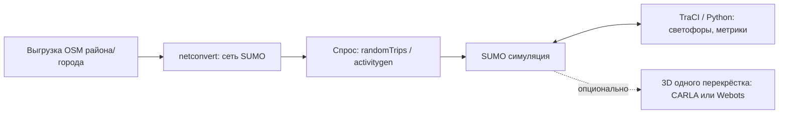
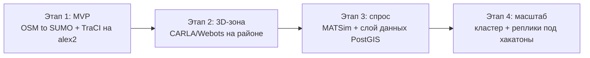

# Фаза 9: Архитектурное ревью стека транспортного моделирования города

> **Документ:** `09-traffic-sim-architecture.md`
> **Версия:** 1.0
> **Статус:** Действующий
> **Область применения:** Центр ИИ, Tech Lead, команда разработки, администрация (запрос на железо)
> **Связанные материалы:** [`briefing.html`](briefing.html), `meeting1.txt`, `meeting2.txt`, [`00-project-charter.md`](00-project-charter.md)

---

## 9.1 Контекст и постановка задачи

Требуется **транспортная модель всего города** (масштаб эталона — Нью-Йорк) с автомобилями и их транспортными потоками, а также с объектами, влияющими на городскую инфраструктуру: здания, светофоры, дорожные знаки, пешеходы, общественный транспорт.

Назначение модели (из `meeting1.txt`, `meeting2.txt`, `briefing.html`):

- основа для хакатонов, привязанных к центру организации дорожного движения и центру ИИ;
- переход интеллектуальной транспортной системы (ИТС) с уровня 0 на уровень 1 (например, детекторы на светофорах с реакцией на поток);
- концепция/модель плана эвакуации города;
- аналитика парковок (ёмкость, загрузка по часам), скорости на отрезках, сбор слоёв данных;
- обучение ИИ-агентов (водители, пешеходы) — задача центра ИИ.

Рассматриваются **две идеи**:

1. **Идея 1.** Использовать **Webots** для всего — построение города из OSM и симуляция всего города в одном инструменте.
2. **Идея 2.** Комбинировать **MATSim + SUMO + CARLA + Webots** в единую систему (предложено в `briefing.html`): MATSim и SUMO — для крупного масштаба, CARLA и Webots — для микроуровня, где важно поведение агентов (водители, пешеходы).

Документ даёт вердикт по обеим идеям, описывает сборки стека для **минимального** (простое, но рабочее) и **идеального** (полная доступность информации через модель) продуктов и формулирует требования к серверу либо, при необходимости, к кластеру серверов.

---

## 9.2 Резюме для руководства (TL;DR)

| Вопрос | Короткий ответ |
|--------|----------------|
| Потянет ли Webots весь город (НЙ) без лагов? | **Нет.** Webots — робототехнический симулятор физики, без оптимизаций под масштаб города. Даже его собственная интеграция с SUMO рендерит лишь ~100 машин рядом с камерой. |
| Идея «всё на Webots» | **Отклонить** для масштаба города. Webots оставить как точечный инструмент микроуровня. |
| Идея комбинированного стека (briefing.html) | **Принять.** Это корректный паттерн многоуровневой (multi-fidelity) ко-симуляции. |
| Полный фотореалистичный реалтайм всего НЙ в 3D | **Нецелесообразно** на разумном бюджете (нужны десятки–сотни GPU). Заменить зональной 3D + LOD. |
| Гибрид реального времени (SUMO near-real-time + CARLA/Webots по зонам) | **Рекомендуется.** Реализуемо на 1 сервере + GPU-узел, масштабируется в кластер под хакатоны. |
| Минимальный продукт | OSM → SUMO (+ TraCI) на текущем `alex2`. Кластер не нужен. |
| Идеальный продукт | MATSim → SUMO → CARLA + Webots + слой данных (PostGIS) + оркестрация на кластере. |

---

## 9.3 Вердикт по Идее 1: «всё на Webots»

**Решение: отклонить для масштаба города. Сохранить Webots как инструмент микроуровня.**

### 9.3.1 Почему Webots не масштабируется на город

Webots — это **симулятор робототехники и физики** (движок на базе ODE). Каждый автомобиль моделируется как детальное физическое тело (колёса, подвеска, контакты), что делает его сильным для одного агента/перекрёстка, но непригодным для сотен тысяч машин одновременно.

Подтверждение из официальной документации и обсуждений Webots:

- В собственной интеграции Webots с SUMO (`PROTO SumoInterface`) параметр **`maxVehicles` по умолчанию = 100**, а параметр **`radius`** ограничивает отрисовку машинами рядом с точкой обзора. То есть «масштаб» в Webots достигается не самим Webots, а внешним SUMO; Webots визуализирует лишь небольшую видимую область. Источник: `cyberbotics/webots`, `docs/automobile/sumo-interface.md`.
- На практике конфигурация с одним кольцевым перекрёстком и **~30 машинами SUMO** на Intel i9-11900 / 32 ГБ / RTX 3080 даёт **просадки до 5 Гц** в случайные моменты. Источник: `cyberbotics/webots` Discussion #4732.
- Официальные рекомендации по ускорению (Discussion #5402) сводятся к отключению рендеринга (Fast mode), теней, вращения колёс и упрощению геометрии — то есть к отказу от того, ради чего Webots и берут.

### 9.3.2 Масштаб проблемы

Нью-Йорк — это порядка **сотен тысяч одновременно движущихся автомобилей** в часы пик (миллионы поездок за сутки). Webots физически не предназначен для такого числа независимых физических тел: ни архитектурно (нет мезоскопической модели/очередей), ни по производительности.

### 9.3.3 Где Webots уместен

- обучение с подкреплением (RL) на уровне **отдельного перекрёстка** или **отдельного агента**;
- робототехнические сценарии, сенсоры, ROS/Python-интеграция;
- задачи центра ИИ, где важна точная физика одного-нескольких агентов.

> Вывод: Webots остаётся в стеке, но как «лист» микроуровня, а не как платформа для всего города.

---

## 9.4 Вердикт по Идее 2: комбинированный стек

**Решение: принять.** Стек `MATSim → SUMO → CARLA + Webots` — это корректный и общепринятый паттерн **многоуровневой ко-симуляции (multi-fidelity / level-of-detail)**: каждый инструмент работает на своём уровне детализации, дорогой фотореализм применяется только там, где он нужен.

### 9.4.1 Роли и уровни

| Уровень | Инструмент | Что моделирует | Масштаб | Режим |
|---------|-----------|----------------|---------|-------|
| Стратегический (спрос) | **MATSim** | Суточный спрос, активности, маятниковые миграции, выбор маршрутов/времени | Весь город, миллионы агентов | Offline, итеративно |
| Сетевой (поток) | **SUMO** | Микро/мезоскопический трафик: светофоры, ОТ, велосипеды, пешеходы | Весь город, тысячи–сотни тысяч авто | Near-real-time (мезо) |
| Микро (3D/ИИ) | **CARLA** | Фотореалистичный район, сенсоры (камеры/LiDAR), RL/AV-агенты | Район, десятки–сотни авто | Реалтайм, по требованию |
| Микро (агент/робот) | **Webots** | Отдельный перекрёсток/агент, точная физика, RL | 1 перекрёсток / единицы агентов | Реалтайм, по требованию |

### 9.4.2 Почему это работает (обоснование по производительности)

- **SUMO** масштабируется на город: мезоскопическая модель (MESO) работает **до 100× быстрее** микроскопической за счёт представления очередей вместо траекторий (источник: SUMO docs, `Simulation/Meso`). Сложность линейна по числу машин; существуют схемы параллелизации (ускорение ~4× без правки ядра). Управление полностью кодом через **TraCI** (Python).
- **CARLA** держит фотореализм только на районе: бенчмарк CARLA показывает ~26 FPS при 50 авто и ~15 FPS при 100 авто (физика + Traffic Manager, GTX 1080 Ti), Traffic Manager однопоточный. Поддерживается **multi-GPU** (primary-сервер физики + secondary-серверы рендера). Источник: CARLA docs (Benchmarking, Multi-GPU), issues #5277/#8793/#4540.
- **MATSim** считает спрос всего города оффлайн (итерации до сходимости), отдавая в SUMO реалистичные потоки.

### 9.4.3 Главные риски стека

- **Сложность интеграции 4 движков:** синхронизация времени, согласование систем координат, конвертация сетей/маршрутов, единый граф города. Это основной источник технического долга (см. раздел 9.10).
- **Точность мезо-модели:** SUMO-MESO систематически недооценивает заторы (arXiv:2606.09282) — для критичных сценариев (эвакуация) использовать микро-модель на нужных зонах.
- **Дисциплина данных:** без единого источника истины по графу города стек распадётся на несинхронные слепки.

---

## 9.5 Целевая архитектура

```mermaid
flowchart TB
  subgraph data [Слой данных города]
    OSM[OSM + 2GIS + кастомные 3D и парковки]
    PG[(PostGIS: сеть, объекты, спрос)]
    OBJ[(Объектное хранилище: видео, сенсоры)]
  end
  subgraph strat [Стратегический уровень - offline]
    MATSim[MATSim: суточный спрос, сценарии]
  end
  subgraph meso [Сетевой уровень - near-real-time]
    SUMO[SUMO micro/meso весь город + TraCI]
  end
  subgraph micro [Микро уровень - по зонам, on-demand]
    CARLA[CARLA: фото-район, RL/AV, сенсоры]
    Webots[Webots: перекрёсток/робот-агент, RL]
  end
  OSM --> PG --> MATSim --> SUMO
  SUMO -->|маршруты, состояния| CARLA
  SUMO -->|локальный трафик| Webots
  CARLA --> OBJ
  SUMO --> PG
```

Принцип: **данные текут сверху вниз по детализации**. Спрос (MATSim) формирует потоки на сети (SUMO); из сети по запросу «вырезается» район для фотореалистичной 3D-симуляции (CARLA) или отдельный перекрёсток для RL (Webots). Результаты (метрики, сенсорные данные) возвращаются в слой данных.

---

## 9.6 Сравнение двух режимов использования

По запросу рассматриваются два целевых режима эксплуатации модели.

### 9.6.1 Вариант 1 — гибрид реального времени (рекомендуется)

- **Суть:** SUMO крутит весь город в near-real-time (мезо-режим), а CARLA/Webots поднимаются **по требованию** на выбранные районы/перекрёстки — для интерактива, демонстраций и обучения ИИ-агентов.
- **Реализуемость:** высокая. Базово — 1 мощный сервер (SUMO) + GPU-узел (CARLA/Webots). Под параллельные команды хакатона — небольшой кластер с изолированными репликами.
- **Плюсы:** реалистично по бюджету; фотореализм там, где он действительно нужен; полный контроль кодом (TraCI / Python API).
- **Минусы:** требуется слой синхронизации SUMO↔CARLA/Webots; мезо-точность ограничена (для критичных зон — микро).

### 9.6.2 Вариант 2 — полный фотореалистичный реалтайм всего НЙ в 3D (отклонить как нецелевой)

- **Суть:** весь Нью-Йорк одновременно в фотореалистичном 3D с поагентной детализацией.
- **Реализуемость:** практически отсутствует на разумном бюджете. Один крупный район в CARLA на сотнях авто уже падает до ~7–15 FPS; весь город фотореалистично = **десятки–сотни GPU** и распределённый рендер, причём готового решения «из коробки» не существует.
- **Рекомендация:** **отклонить** в пользу **зональной 3D + LOD** — фотореалистично отрисовывается только видимая/выбранная область, остальной город живёт в SUMO (мезо) как «обёртка-имитация». Визуально и аналитически это даёт «весь город», а вычислительно остаётся реализуемым.

> Итог: целевой режим — **Вариант 1**. Вариант 2 фиксируется как анти-цель с обоснованием, чтобы не тратить бюджет администрации на недостижимую конфигурацию.

---

## 9.7 Минимальный продукт (MVP — «простое, но рабочее»)

Цель MVP: получить **рабочую модель города на реальной сети** с управлением кодом и базовой 3D-демонстрацией, на **существующем железе**, без кластера.

### 9.7.1 Поток данных MVP

### 9.7.2 Состав MVP

- **Сеть:** OSM → `netconvert` → сеть SUMO (улицы, полосы, светофоры).
- **Спрос:** базовый — `randomTrips` / `activitygen` (позже заменяется на MATSim).
- **Управление и аналитика:** TraCI (Python) — переключение светофоров, сбор метрик (скорости на отрезках, загрузка, очереди).
- **Объекты инфраструктуры:** дороги, светофоры, знаки, остановки/ОТ, пешеходы — из OSM (пешеходы — встроенная модель SUMO).
- **3D (опционально):** один перекрёсток в CARLA **или** Webots для демонстрации и первых RL-экспериментов.

### 9.7.3 Железо MVP

- Достаточно существующего **`alex2`** (AMD Ryzen 5 5600, 32 ГБ DDR4, RTX 4070, 12 ГБ).
- **Кластер не требуется.** SUMO + одиночный CARLA/Webots укладываются в один узел.

---

## 9.8 Идеальный продукт (полная доступность информации)

Цель: **полная информационная доступность через модель** — от суточного спроса до сенсорных данных конкретного перекрёстка, с воспроизводимыми сценариями и поддержкой нескольких команд.

### 9.8.1 Состав

- **Полный стек:** MATSim (спрос/сценарии) → SUMO (мезо весь город + микро по выбранным зонам) → CARLA (фото-районы, сенсоры, RL/AV) + Webots (перекрёсток/робот-агенты).
- **Слой данных:**
  - **PostgreSQL + PostGIS** — единый граф города (сеть, объекты, спрос, парковки, скорости);
  - **объектное хранилище / NAS** — видео и сенсорные данные CARLA;
  - **единый источник истины по графу** (OSM + кастомные 3D-модели + полигоны парковок из `meeting1.txt`).
- **Интеграция / ко-симуляция:** коннекторы и шина синхронизации SUMO↔CARLA/Webots; конвертеры сетей и маршрутов; согласование времени и координат.
- **Оркестрация:**
  - контейнеризация (Docker) всех движков;
  - очередь/планировщик сценариев (батч-прогоны MATSim/SUMO);
  - **изолированные реплики на каждую команду хакатона** (см. открытый вопрос о выделении реплик в `meeting1.txt`);
  - доступ из кампуса и удалённо (VPN / Tailscale).

### 9.8.2 Атрибуты качества

- **Воспроизводимость:** сценарий = версионируемый набор входных данных (граф + спрос + конфиг) в Git/хранилище (соответствует Принципу 2 устава — GitHub как источник истины).
- **Наблюдаемость:** метрики симуляции и ресурсов узлов (для контроля «лагов» и масштабирования).
- **Эволюционируемость:** замена/добавление движка не ломает слой данных (развязка через PostGIS и коннекторы).

---

## 9.9 Требования к серверу и кластеру

> Ниже — ориентиры для запроса к администрации. Точные значения уточняются после профилирования на реальной сети города.

### 9.9.1 MVP (один узел)

- CPU: 6–12 ядер (текущий Ryzen 5 5600 — достаточно для старта).
- RAM: 32 ГБ (минимум для городской сети SUMO + один CARLA/Webots).
- GPU: 1× RTX 4070 (12 ГБ) — CARLA, RL, faster-whisper.
- Диск: 1–2 ТБ NVMe.
- Вывод: **`alex2` готов**, кластер не нужен.

### 9.9.2 Вариант 1 — гибрид реального времени (рабочая конфигурация)

- **CPU-узел(ы) — MATSim / SUMO:** упор на число ядер и RAM. Рекомендация: 16–32 ядра, 64–128 ГБ RAM на узел (мезо весь город + параллельные сценарии).
- **GPU-узел(ы) — CARLA / Webots:** 1 современный GPU (RTX 4070+/4080+, ≥12 ГБ) **на одну интерактивную сессию/реплику**; для multi-GPU CARLA — несколько GPU в одном узле (primary физика + secondary рендер).
- **Хранилище:** NAS / сервер на **8–16+ ТБ** под видео и сенсорные данные CARLA.
- **Сеть:** доступ из кампуса и удалённо (VPN / Tailscale).
- **Масштаб под хакатон:** число GPU-реплик ≈ число одновременных команд, нуждающихся в 3D/RL; CPU-узлы шарятся между командами для SUMO/MATSim.

### 9.9.3 Вариант 2 — полный фотореалтайм всего НЙ (не рекомендуется)

- Требует **десятков–сотен GPU** и распределённого рендера; готового решения нет.
- **Рекомендация:** не закладывать в бюджет; вместо этого — зональная 3D + LOD (раздел 9.6.2), что укладывается в конфигурацию Варианта 1.

### 9.9.4 Когда нужен кластер (триггеры)

- несколько команд хакатона одновременно требуют интерактивный 3D/RL;
- параллельные батч-прогоны MATSim/SUMO для разных сценариев;
- генерация больших объёмов сенсорных данных CARLA для обучения ИИ;
- требование изоляции окружений между командами (реплики).

---

## 9.10 Риски, технический долг и дорожная карта

### 9.10.1 Ключевые риски

| Риск | Влияние | Митигирование |
|------|---------|---------------|
| Сложность интеграции 4 движков | Высокое | Развязка через слой данных (PostGIS) и коннекторы; начать с SUMO, добавлять движки поэтапно |
| Недооценка заторов в SUMO-MESO | Среднее | Микро-модель на критичных зонах (особенно для плана эвакуации) |
| Расхождение версий графа города | Высокое | Единый источник истины по графу; версионирование сценариев |
| Недооценка железа под 3D/RL | Среднее | Профилирование на реальной сети до запроса кластера; начать с `alex2` |
| Соблазн «всё на Webots» / «весь НЙ в фото» | Высокое (бюджет) | Зафиксированные вердикты разделов 9.3 и 9.6.2 |

### 9.10.2 Поэтапная дорожная карта

1. **Этап 1 (MVP):** OSM → SUMO + TraCI на `alex2`; базовые метрики (скорости, загрузка, парковки).
2. **Этап 2 (3D-зона):** подключить CARLA/Webots на одном районе/перекрёстке; первые RL-эксперименты центра ИИ.
3. **Этап 3 (спрос и данные):** добавить MATSim и слой данных (PostGIS + хранилище), единый граф города.
4. **Этап 4 (масштаб):** контейнеризация, оркестрация, GPU-узлы и реплики под параллельные команды хакатона.

> Принцип (по Закону Галла из `08-implementation-roadmap.md`): не внедрять всё сразу — наращивать сложность только при доказанной необходимости.

---

## 9.11 Итоговые рекомендации

1. **Отклонить** «всё на Webots» для масштаба города; оставить Webots как инструмент микроуровня (перекрёсток/агент, RL).
2. **Принять** комбинированный стек `MATSim → SUMO → CARLA + Webots` как многоуровневую ко-симуляцию.
3. **Целевой режим — Вариант 1** (гибрид реального времени). **Вариант 2** (полный фотореалтайм НЙ) — отклонить, заменить зональной 3D + LOD.
4. **Начать с MVP на `alex2`** (OSM → SUMO → TraCI); кластер запрашивать только по триггерам раздела 9.9.4.
5. **Заложить слой данных (PostGIS) и единый граф города** уже на ранних этапах — это снижает основной технический долг интеграции.

---

## 9.12 Источники

- SUMO Mesoscopic model — `https://eclipse.dev/sumo/docs/Simulation/Meso.html`
- SUMO computational complexity — `https://github.com/eclipse-sumo/sumo/issues/16316`
- Ограничения SUMO-MESO (недооценка заторов) — arXiv:2606.09282
- Webots SUMO interface (`maxVehicles`, `radius`) — `https://github.com/cyberbotics/webots/blob/master/docs/automobile/sumo-interface.md`
- Webots: просадки на ~30 машинах — Discussion #4732; ускорение симуляции — Discussion #5402
- CARLA Benchmarking (FPS vs число авто) — `https://carla.readthedocs.io/en/0.9.12/adv_benchmarking/`
- CARLA Multi-GPU — `https://carla.readthedocs.io/en/latest/adv_multigpu/`
- CARLA: лимит авто / однопоточный Traffic Manager — issues #5277, #8793, #4540

---

*Документ подлежит пересмотру после профилирования MVP на реальной сети города или при изменении состава стека.*
