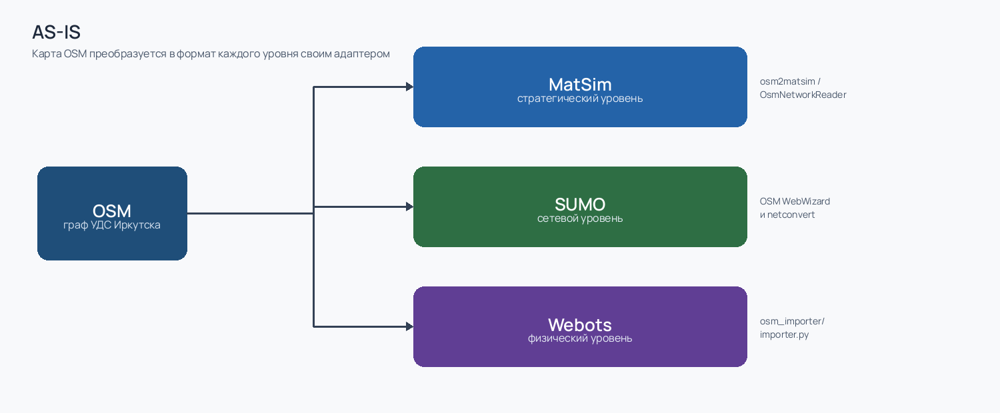
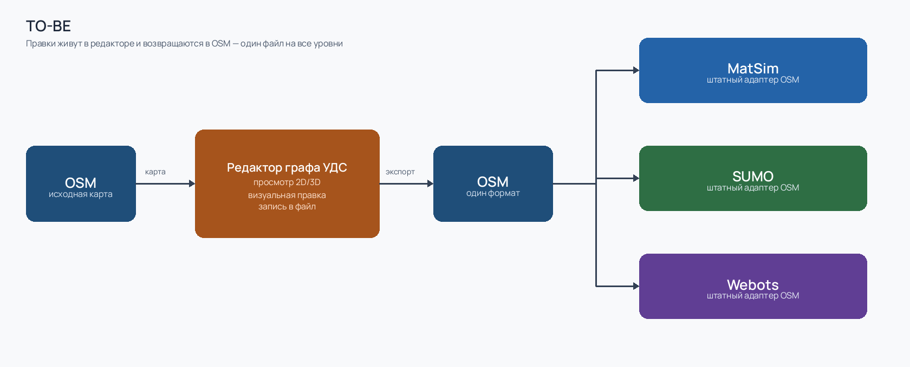
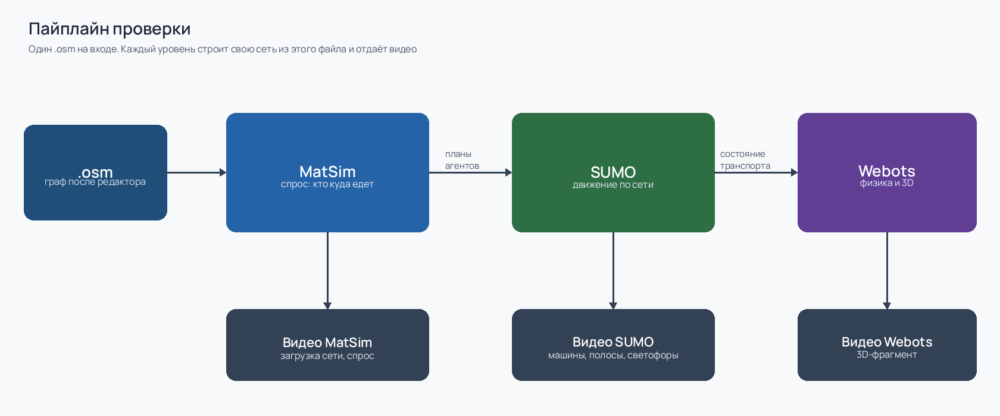
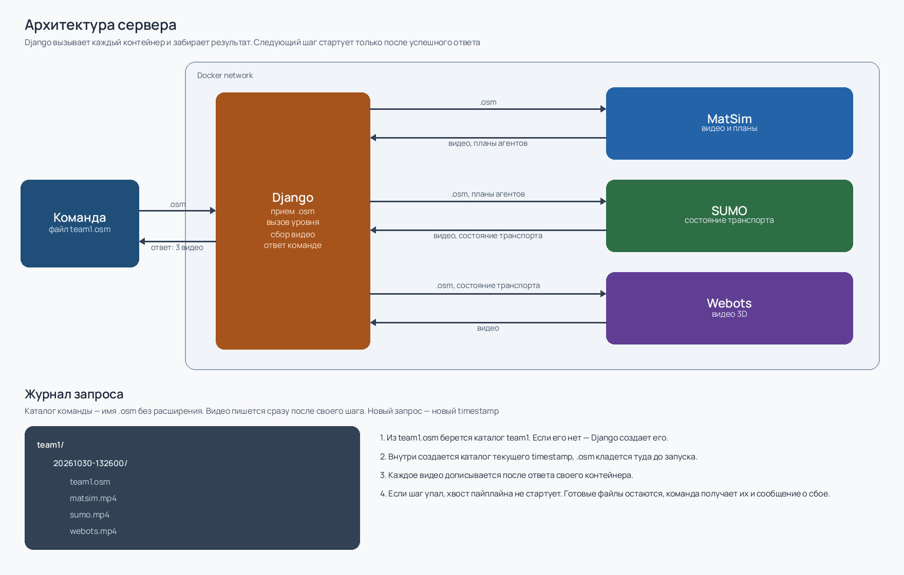

## Введение:

Для управления решениями транспортной инфраструктуры используется трехуровневая модель MatSim-SUMO-Webots.

* MatSim - стратегический уровень, генерация спроса кто куда едет
* SUMO - сетевой уровень, отображение транспорта на графе УДС (улично-дорожной сети)
* Webots - физический уровень, транспортное поведение с учетом физики

Для запуска симуляций на вход каждого уровня подается граф УДС. Для каждого уровня формат графа уникален (но каждый описан как xml файл).

## AS-IS:



В качестве графа УДС Иркутска берется карта OSM. У уровней есть свои адаптеры для преобразования карты OSM в свой xml формат:

- MatSim: osm2matsim / org.matsim.core.utils.io.OsmNetworkReader
- SUMO: OSM WebWizard и netconvert
- Webots: встроенный скрипт WEBOTS_HOME/resources/osm_importer/importer.py

## Проблема:

Данные OSM подходят для демо, но не для принятия решений поскольку имеют значительные отклонения от реального графа УДС. Предлагается взять за основу граф с OSM и дорабатывать его в рамках Иркутска. Существующие инструменты редактирования графа УДС не предусматривают экспорт в необходимый формат или являются проприетарными.

## TO-BE:



Возможности редактора графа УДС:

- Отобразить граф УДС, записанный в формате OSM (2D/3D)
- Визуально редактировать граф УДС
- Записывать визуальные изменения обратно в файл OSM

Один из вариантов экспорта — обратно в OSM. MatSim, SUMO и Webots имеют адаптеры под формат OSM: импорт и экспорт из редактора идут в одном формате, один файл на все уровни.

## Задание:

Разработать редактор графа УДС. Исходные данные — карта OSM. Результат работы редактора — файл `.osm`, пригодный для проверки в MatSim, SUMO и Webots.

**Обязательный функционал**:

1. **Открыть граф.** Загрузить `.osm` и показать УДС в 2D.
2. **Править граф.** Визуально менять сеть: узлы, ребра, направления, полосы, перекрестки, мосты, светофоры и другие атрибуты дорог.
3. **Сохранить граф.** Записать правки обратно в `.osm` или экспортировать как отдельный `.osm` файл.

Будет плюсом:

1. Просмотр в 3D.
2. Функционал для комфортного редактирования графа: hotkeys, шаблоны элементов дорог, автозаполнение дорог, плавный переход по Z координате для участка дороги, ....
3. Подсветка ошибок редактирования (характерно для OSM): изолированные ребра, неверные направления, склеенные или разорванные перекрестки.
4. Проверка связности графа перед сохранением.
5. Подложка снимка или схемы реальной УДС рядом с редактируемым графом (по API из 2ГИС, Яндекс Карты, Google Maps, ... или собрать скриншотами из карт).
6. Исполняемый файл редактора или docker-образ без ручной сборки окружения.
7. Другие полезные фичи

## Отправка решения:

Для проверки полученного графа УДС файл OSM отправляется на сервер, где проверяется в MatSim, SUMO и Webots. Результатом проверки являются видео визуализации с каждого уровня. Точность визуализации транспортной инфраструктуры и поведения определяет итоговую оценку кейса.

Команда сдает файл `.osm`, который этот редактор записал. Серверные адаптеры и сценарий спроса фиксированы организатором: их не переписывают и не подменяют готовыми ответами.
Командам будет предоставлен доступ к github репозиторию, в котором размещается исходный код редактора. Значительный плюс - наличие исполнительного файла редактора или docker-образа.

### Пайплайн:



На вход сервера подается один файл `.osm` — граф УДС после редактора. Сервер сам строит из него сеть каждого уровня. Между уровнями помимо графа предетаются результаты предыдущего уровня: MatSim отдает маршруты спроса, SUMO — состояние транспорта, Webots показывает это состояние в 3D.

#### MatSim

Стратегический уровень. Сервер читает `.osm` и собирает сеть: узлы, ребра, допустимые скорости и пропускную способность.

На этой сети считается суточный спрос. Население задано сценарием организатора: агенты с планами активностей (дом, работа, прочие поездки). Каждый агент выбирает маршрут и время выезда. Несколько итераций сдвигают выбор к равновесию: загруженные ребра становятся менее выгодными, часть потока уходит на другие связи графа.

На выходе уровня:

- планы агентов — кто, откуда, куда и по каким ребрам едет; этот результат передается в SUMO;
- видео загрузки сети: где концентрируется спрос и какие связи графа вообще используются.

По видео видно, выдерживает ли отредактированный граф роль дорожной сети: нет ли обрывов, изолированных кусков и ребер с неверным направлением, по которым поток пройти не может.

#### SUMO

Сетевой уровень. Сервер заново строит сеть SUMO из того же `.osm`: полосы, перекрестки, приоритеты, светофорные фазы. Маршруты берутся из планов MatSim.

Дальше идет микросимуляция. У каждого автомобиля есть скорость, ускорение и смена полосы; на перекрестках работают светофоры и правила приоритета. Сервер записывает видео движения по сети.

По видео видно то, чего нет на схеме спроса: число полос, форму перекрестка, наличие светофора, разрывы, из-за которых машины телепортируются или стоят. Движение идет по тем улицам, которые участник оставил и поправил в редакторе.

#### Webots

Физический уровень. Сервер импортирует из `.osm` трехмерную геометрию фрагмента сети: проезжую часть, перекрестки и объекты, которые есть в выгрузке. Весь город в Webots не считается. Берется участок, на котором уже есть поток из SUMO.

На каждом шаге Webots получает из SUMO положение, скорость, курс и тип транспортного средства и ставит модель на дорогу. Записывается видео этого участка.

По видео видно, совпала ли трехмерная геометрия с графом: машины едут по проезжей части, не проваливаются сквозь покрытие и не срезают углы там, где после правки должна быть связная улица.

### Пример для запуска:

Пример показывает, что сервер принимает сырой OSM и отдает три видео. С ним сравнивают решение команды. География фрагмента одна и та же для всех команд. Это не готовая модель города и не сценарий, который нужно воспроизвести своим кодом.

Дефолтный файл `.osm` предоставляет организатор.

Как он получен:

1. Источник — OpenStreetMap, фрагмент УДС Иркутска в границах от "Остановка Госуниверситет" до "Остановка Жуковского".
2. Выгрузка через Overpass API одним XML-файлом OSM. В запрос входят дороги (`highway`), трамвайные пути, светофоры, пешеходные переходы, остановки общественного транспорта и здания внутри этих границ.
3. Файл не правят в редакторе и не переводят заранее в сети MatSim, SUMO или Webots. В пайплайн уходит тот же `.osm`, который потом сдают команды.

Как запускается:

1. Дефолтный `.osm` отправляется на сервер проверки тем же способом, что и решение команды.
2. Сервер прогоняет пайплайн и возвращает три видео: спрос MatSim, движение SUMO, 3D-фрагмент Webots.
3. Эти видео — пример сырой карты. На них остаются типичные отклонения OSM от реальной УДС: лишние и потерянные ребра, неверные направления, склеенные или разорванные перекрестки, пропущенные светофоры.
4. Решение команды — другой `.osm`, собранный в редакторе из той же исходной карты. Жюри сравнивает видео решения с примером и с реальной УДС: инфраструктура должна стать точнее, поведение транспорта — устойчивее.

### Архитектура сервера:



На сервере четыре контейнера в одной Docker-сети: Django, MatSim, SUMO, Webots. Снаружи доступен Django. MatSim, SUMO и Webots друг друга не вызывают: следующий уровень стартует только после того, как Django получил ответ предыдущего.

Порядок прогона:

1. Django принимает `.osm` и сразу кладет его в каталог прогона. Файл запроса уже сохранен, даже если дальше пайплайн оборвется.
2. Django отдает `.osm` в MatSim и ждет видео и планы агентов.
3. После успешного MatSim Django отдает в SUMO `.osm` и планы агентов и ждет видео и состояние транспорта.
4. После успешного SUMO Django отдает в Webots `.osm` и состояние транспорта и ждет видео.
5. В ответ команде уходят собранные видео.

Если шаг не завершился — ошибка контейнера, таймаут или пустой результат — хвост пайплайна не запускается. Нет планов агентов, значит нет вызова SUMO. Нет состояния транспорта, значит нет вызова Webots. Уже готовые видео остаются в каталоге этого прогона, рядом пишется, на каком шаге он остановился. Команда получает эти видео и сообщение о сбое, а не пустой обрыв. Пример: MatSim записал `matsim.mp4`, SUMO упал. В каталоге лежат `team1.osm` и `matsim.mp4`, файлов SUMO и Webots нет, Webots не вызывался.

Журнал запроса:

1. Из имени файла берется каталог команды: `team1.osm` дает каталог `team1`. Если каталога нет, он создается.
2. Внутри создается каталог с именем текущего timestamp.
3. Туда сразу кладется `.osm`. Каждое видео дописывается после ответа своего контейнера, а не одной пачкой в конце.

Повторная отправка не затирает прошлый прогон, в том числе неудачный: появляется новый каталог timestamp.

```
team1/
  20261030-132600/
    team1.osm
    matsim.mp4
    sumo.mp4
    webots.mp4
```

## Презентация:

Решение проходит устную защиту перед жюри. Рекоммендуется придерживаться следующему содержанию:

1. **Задача.** Проблема: OSM подходит для демо, но расходится с реальной УДС Иркутска, а существующие редакторы не отдают граф в формат, который принимают MatSim, SUMO и Webots. Гипотеза команды: какие правки графа они считают достаточными и почему после записи обратно в OSM инфраструктура и движение на трех уровнях должны стать точнее.
2. **Команда.** Участники и роль каждого в задаче: кто делал редактор, кто разбирал граф фрагмента, кто проверял экспорт и видео пайплайна, кто собирал защиту. Совмещенные роли называют прямо.
3. **Решение.** Как устроен редактор: просмотр графа OSM в 2D или 3D, какие правки вносятся визуально, как изменения записываются обратно в `.osm`. Что лежит в github-репозитории. Если есть исполняемый файл или docker-образ — как его запустить.
4. **Демонстрация.** Один фрагмент, от остановки Госуниверситет до остановки Жуковского:
   - дефолтный `.osm` и ошибки сырой карты, которые команда взяла в работу;
   - граф после редактора и какие из этих ошибок убраны;
   - три видео сервера (MatSim, SUMO, Webots) на сданном файле: что изменилось в спросе, движении и 3D относительно примера сырой карты.
5. **Границы.** Какие расхождения с реальной УДС остались и почему, как можно исправить.

## Оценка кейса:

Оценка делится на допуск и баллы жюри. Итог — сумма баллов, максимум 100.

Допуск, одинаковый для всех:

- сдан исходный код редактора;
- присутствует весь **обязательный функционал**;
- сдан файл `.osm` и пайплайн завершается на MatSim, SUMO и Webots без ручной доводки файла;
- на выходе есть три видео;

Критерии жюри делятся на три категории:

1. **Оценка редактора (50 баллов)**
    - **Обязательный функционал — 20 баллов.** Полнота выполнения обязательного функционала.
    - **Удобство и плюсы — 30 баллов.** Насколько удобно использовать редактор. Для каждой фичи необходимо аргументировать ее ценность.
2. **Оценка точности симуляции (30 баллов)**
    - **Инфраструктура — 15 баллов.** На трех видео граф ближе к реальной УДС, чем дефолтный `.osm`: связность, направления, полосы, перекрестки, светофоры, мосты.
    - **Поведение транспорта — 15 баллов.** Спрос и движение согласованы с сетью; нет систематических обрывов, телепортаций, зацикливаний и проезда вне проезжей части; в 3D геометрия совпадает с графом; одна правка видна на всех трех уровнях.
3. **Оценка презентации (20 баллов)**
    - **Состав защиты — 10 баллов.** Есть все части раздела презентации (5 баллов), содержание логически связано, четко и понятно донесено жюри и аудитории (5 баллов)
    - **Демонстрация и ответы — 10 баллов.** Обоснована ценность редактора, команда отвечает на вопросы жюри.
